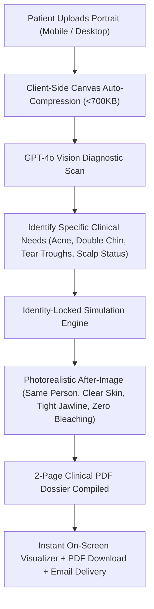

# ClinicNextFace / MogaFace: System Vision, Goals & Aesthetic Simulation Manifesto

## 1. Executive Summary & Core Mission

**ClinicNextFace** is an aesthetic medicine clinic specializing in non-surgical facial rejuvenation, dermatological health, facial contouring, and hair restoration.

**MogaFace** is the proprietary AI-powered digital consultation engine built for the clinic. Its primary objectives are:
1. **Frictionless Lead Capture**: Prospective patients upload their diagnostic portrait photos (and optional video) from mobile or desktop.
2. **Clinical-Grade Facial Assessment**: Automated anatomical analysis identifying specific concerns (acne, hyperpigmentation, double chin / submental fullness, tear troughs, forehead lines, scalp density).
3. **Medically Plausible "After" Simulation**: Generate a photorealistic visual demonstration of what realistic non-surgical treatments would achieve on *their exact face*.
4. **High-Converting Clinical Dossier**: Compile a bespoke 2-page Clinical Consultation PDF Report delivered to the user to convert digital inquiries into paid clinic appointments.

---

## 2. Fundamental Rules & Clinical Non-Negotiables

### Rule 1: Strict Identity Preservation (Zero Face-Swapping)
* **The patient must remain 100% undeniably themselves.**
* The AI must **NEVER** substitute the patient's face with a generic stock model, Bollywood actor, or altered persona.
* **Locked Anatomy**:
  * **Nose**: Exact same nasal bridge, tip, nostril width, and profile.
  * **Eyes & Brows**: Exact same inter-pupillary distance, eye shape, eyelid fold, and brow arch.
  * **Skeletal Structure**: Exact same skull geometry, cheekbone width, jaw angles, and chin projection.
* The simulation is an **enhancement of their existing features**, NOT a new human.

### Rule 2: Hair Authenticity Lock (No Hallucinated Hair)
* **Bald / Shaved Scalp**: If a patient is bald, balding, or shaved, the simulation **must keep them bald/shaved with a clean, healthy scalp**. Under no circumstances should the system hallucinate a pompadour, wig, or fake hair.
* **Hairline Restoration**: Only when hair restoration is explicitly requested, restore natural density along their *own* original hairline—never changing hair texture, curl pattern, or hairstyle.

### Rule 3: Achievable Non-Surgical Clinical Outcomes Only
The visual changes must strictly reflect what modern aesthetic medicine can achieve:
* **Dermal Clarity (Chemical Peels & Lasers)**: Eliminate acne pustules, papules, red spots, blemishes, and uneven tone.
* **Submental Debulking (Kybella / HIFU / Dermal Fillers)**: Reduce soft-tissue fullness under the chin (double chin) and firm the mandibular border along the patient's *own* jawline.
* **Tear Trough Softening (Hyaluronic Fillers)**: Lessen under-eye hollows, shadowing, and tired dark circles.
* **Neuromodulators (Botox / Dysport)**: Smooth dynamic horizontal forehead lines, glabellar frown lines (11s), and crow's feet.

### Rule 4: Photorealistic Skin Texture (No Plastic Wax Doll)
* Output must look like a **real, high-resolution DSLR photograph**, not a cartoon, CGI render, or heavy Instagram filter.
* Skin must retain **authentic pore texture, fine dermal grain, and natural specular lighting highlights**.
* **Zero Plastic Blur**: Never apply heavy airbrushing or porcelain-doll blurring.

### Rule 5: Complexion & Melanin Integrity (Zero Bleaching)
* The patient's natural skin tone and melanin depth (Indian, brown, tan, olive, deep) must be **strictly preserved**.
* **Never lighten, whiten, or bleach skin tone**.

---

## 3. Root Cause Analysis: Why Earlier Iterations Failed

| Generation Method | Observed Result | Why It Failed |
| :--- | :--- | :--- |
| **`gpt-image-2.5-sunburst`** | Bleached brown skin, washed out facial details, almost zero contouring. | Substandard image model with strong Western bias that tends to over-expose and lighten skin pigments. |
| **`chatgpt-image-latest` (Whole-image prompt)** | Placed a Bollywood pompadour on a bald patient, changed nose and eyes into a generic model. | Whole-image diffusion generates images from pure random noise. Without spatial landmark constraints, the model denoises toward its training dataset average for "attractive male", inherently altering bone structure and hair. |

---

## 4. Architectural Solutions for 100% Identity Lock

To completely eliminate identity drift and ensure surgical accuracy, we have two proven technical architectures:

### Pathway A: Landmark-Guided Inpainting Mask (Recommended)
* Use **MediaPipe Face Mesh** (already built into MogaFace) to create a protective binary mask:
  * **Protected Zone (Untouchable)**: Eyes, nose, mouth/lips, skull shape, and scalp/hair are locked 100% pixel-perfect.
  * **Active Inpainting Zones**: Only the skin blemish areas (for acne/hyperpigmentation clearance) and the lower jawline/chin boundary (for double-chin reduction) are modified.
* **Advantage**: The patient's core features physically *cannot* change because those pixels are directly copied from the original photo.

### Pathway B: Deterministic Anatomical Contouring (Plastic Surgery Software Model)
* Similar to clinical 3D simulation software (Crisalix / Vectra / Mirror):
  * Landmark vectors along the mandibular border and submental fat pocket are mathematically contracted by 10–15% using mesh warping.
  * Algorithmic skin blemish extraction and healing filters are applied directly to the dermal layer.
* **Advantage**: Zero AI hallucination, instantaneous processing, 100% mathematical guarantee of personal identity.

---

## 5. End-to-End User Experience & Flow

---

## 6. Project Roadmap & Status

| Phase | Deliverable | Status |
| :--- | :--- | :--- |
| **M1: Test Lab** | `/test-lab` for zero-question direct photo/video testing | **Complete & Live** |
| **M2: Upgraded Model** | Switched from `gpt-image-2.5-sunburst` to `chatgpt-image-latest` | **Complete & Live** |
| **M3: Mobile 413 Fix** | Client-side auto-compression preventing Vercel 4.5MB payload limit | **Complete & Live** |
| **M4: Identity & Hair Lock** | Strict prompt rules for bald scalp and bone structure preservation | **Implemented & Live** |
| **M5: Landmark Masking** | Region-specific inpainting locking T-zone (eyes/nose/mouth) against all drift | **Next Implementation** |
| **M6: Consultation Dossier** | Luxury 2-page branded PDF consultation report | **Complete & Live** |

---

## 7. Key Doubts & Decisions to Confirm

1. **Simulation Engine Preference**:
   * Do you prefer **Pathway A (Landmark-Guided Inpainting)** where the AI can only touch the skin blemishes and jawline edge, while eyes, nose, and mouth are physically untouchable?
   * Or **Pathway B (Deterministic Anatomical Warping)** like Vectra plastic surgery software?
2. **Hair Restoration Policy**:
   * Should the system **strictly lock the patient's existing hair/scalp by default** (if bald, stay bald; if shaved, stay shaved), and only simulate hair restoration if the user explicitly opts in via a toggle?
3. **Primary User Flow**:
   * Should the `/test-lab` style instant on-screen Before/After visualizer become the primary homepage experience (fast scan -> see result immediately -> get dossier), or keep the multi-step questionnaire intake?
