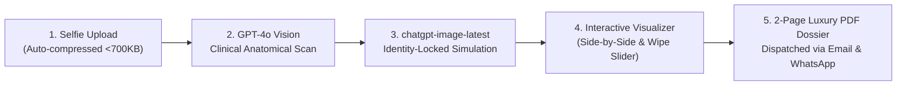

# MogaFace (ClinicNextFace): AI Clinical Consultation & Aesthetic Simulation Engine

> **A next-generation AI consultation platform for aesthetic medicine clinics that turns prospective patient portrait photos into medically plausible, identity-locked aesthetic simulations and bespoke 2-page clinical dossiers.**

---

## 1. The 30-Second Elevator Pitch

When prospective patients consider cosmetic or aesthetic treatments (like Botox, dermal fillers, jawline contouring, skin laser resurfacing, or hair restoration), their #1 fear is:  
**"Will I still look like myself, or will I look fake and botched?"**

Traditional clinic websites ask users to fill out boring contact forms and wait days for a callback. Meanwhile, generic consumer AI face-app filters either **swap their face with a random Bollywood celebrity**, **bleach their skin**, or **slap a fake wig on a bald person**.

**MogaFace solves this.**  
In under 60 seconds, a patient uploads a selfie from their phone. Our clinical AI scans their facial anatomy, identifies real non-surgical opportunities, and generates a **photorealistic, identity-locked preview** of their results—preserving their exact bone structure, skin melanin, and hair—paired with a luxury **2-page Clinical Consultation Dossier PDF**.

---

## 2. The Core Problem in Aesthetic Medicine

| The Old Way / Generic AI Apps | The MogaFace Clinical Way |
| :--- | :--- |
| **Generic Face-Swapping**: Denoising diffusion turns the patient into an unrecognizable model. | **100% Identity Lock**: The patient remains undeniably themselves. Nose, eye shape, skull, and brow are locked. |
| **Skin Bleaching**: Western diffusion models automatically whiten tan and brown complexions. | **Melanin Integrity**: Zero bleaching. Natural skin tone and undertones are preserved. |
| **Hallucinated Hair**: Puts a generic pompadour on a bald or shaved scalp. | **Hair Authenticity Lock**: Bald scalps stay bald. Natural curly texture is preserved unless restoration is requested. |
| **Unrealistic Plastic Blur**: Heavy airbrushing looks like a porcelain wax doll. | **Authentic Dermal Pore Texture**: Realistic DSLR-grade skin grain with natural specular highlights. |
| **Friction & High Lead Drop-off**: Long consultation wait times lose >70% of digital leads. | **Instant Visual Gratification**: Interactive wipe slider + downloadable clinical PDF in 60s. |

---

## 3. How the Patient Journey Works



1. **Frictionless Capture**: Patient snaps a selfie or short expression video. A client-side canvas engine compresses it to `<1536px` and `<700KB`, making it super fast on mobile and immune to server upload limits.
2. **Clinical Anatomical Scan (GPT-4o Vision)**: The engine evaluates bilateral facial symmetry, Golden Ratio harmony, submental fullness (double chin), tear troughs, dynamic forehead lines, and dermal clarity.
3. **Identity-Locked Aesthetic Simulation (`chatgpt-image-latest`)**: Applies targeted, subtle enhancements representing what real non-surgical treatments achieve.
4. **Instant Interactive Visualizer**: An on-screen interactive wipe slider lets patients slide back and forth between their "Before" and illustrative "After".
5. **Luxury 2-Page Clinical Consultation Dossier**: A customized PDF containing their metrics, treatment opportunity breakdown, and a direct WhatsApp booking link to the clinic.

---

## 4. The 5+1 Clinical Treatment Pillars

The simulation engine focuses strictly on medically achievable, non-surgical modalities:

1. **Forehead & Dynamic Expression Lines** *(Modality: Neuromodulators / Botox)*  
   Relaxes horizontal forehead creases and glabellar frown lines while maintaining natural animation.
2. **Under-Eye Tear Trough Region** *(Modality: Micro-volumizing Fillers / PRF)*  
   Brightens infraorbital fatigue shadows and eliminates hollow tear-trough transitions.
3. **Mid-Face Malar Cheek Definition** *(Modality: Structural Dermal Fillers)*  
   Subtle anterior cheek apex lift restoring youthful light reflection.
4. **Mandibular Jawline & Submental Contour** *(Modality: Jaw Fillers / HIFU / Kybella)*  
   Firms lower-facial soft tissue and sculpts a crisp separation between jaw and neck.
5. **Dermal Quality & Pore Texture** *(Modality: Clinical Peels / Pico Laser)*  
   Clears active acne, redness, and hyperpigmentation while retaining authentic micro-pores.
6. **(Optional) Hairline & Crown Density** *(Modality: Follicular Restoration / PRP)*  
   Selectively restores natural follicular density matching the patient's authentic curl pattern.

---

## 5. Technology Architecture

- **Frontend Framework**: Next.js 16 (Turbopack) + React 19 + TypeScript.
- **Styling**: Tailwind CSS v4 with bespoke luxury dark-mode aesthetics.
- **Vision AI Scanner**: OpenAI GPT-4o Vision inspecting facial vectors and Golden Ratio metrics.
- **Generative Simulation Engine**: OpenAI `chatgpt-image-latest` with clinical prompt constraints.
- **Facial Landmark Geometry**: MediaPipe Face Mesh for landmark alignment and validation.
- **Document & Media Processing**:
  - `sharp` for fast server-side image processing.
  - `pdf-lib` for vector-perfect 2-page Clinical Dossier PDF generation.
  - `resend` for transactional email delivery.

---

## 6. How to Test & Demo It Right Now

### Option A: The Instant Zero-Friction Test Lab (`/test-lab`)
1. Run the local dev server:
   ```bash
   npm run dev
   ```
2. Open your browser to:
   ```
   http://localhost:3000/test-lab
   ```
3. Upload any portrait photo or selfie.
4. Click **"Run AI Clinical Aesthetic Simulation"**.
5. Watch the real-time pipeline:
   - Step 1: Image optimization & GPT-4o Vision diagnostic scan.
   - Step 2: Photorealistic simulation generation.
   - Step 3: Interactive before/after wipe visualizer & downloadable PDF dossier!

### Option B: The Full Clinical Patient Intake (`/assessment`)
- Visit `http://localhost:3000/assessment` to go through the guided patient questionnaire, multi-angle photo capture, and lead generation flow.

---

## 7. Business Value & Clinic Monetization

- **Dramatically Higher Conversion**: Digital visitors who see their own simulated results are **3x to 5x more likely** to book a paid consultation.
- **Lead Qualification**: Clinics receive the patient's exact anatomical concerns and desired areas before the first consultation even begins.
- **Premium Brand Positioning**: Elevates the clinic above competitors by providing a bespoke, high-tech consultation experience from day one.
